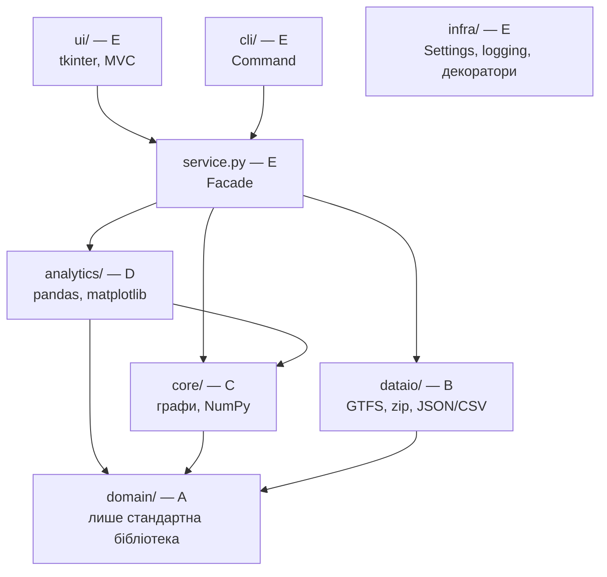

# CityMove — Спринт 2: завдання ролей і рефакторинг під патерни

Стан на `main` @ `b5f0c5d` (2 листопада 2026): 99 тестів зелені, `python run_tests.py --e2e` проходить.
Усі цифри нижче отримано на копії репозиторію з київським фідом `data/gtfs_static`. На ваших ноутбуках абсолютні числа будуть інші, а співвідношення — ті самі.

Як читати: розділи 0–3 читають усі (що погано, як має бути, переїзд). Розділ 4 — кожен свою роль на свій тиждень. Розділи 5–8 — залежності, ротація, демо, ризики.

**Зміст**

- [0. Коротко](#0-коротко)
- [1. Що зараз погано](#1-що-зараз-погано)
- [2. Як має бути](#2-як-має-бути)
- [3. Крок 0 — переїзд на пакети (один PR)](#3-крок-0--переїзд-на-пакети-один-pr)
- [4. Ролі по тижнях](#4-ролі-по-тижнях)
  - [Роль A — domain](#роль-a--domain)
  - [Роль B — dataio](#роль-b--dataio)
  - [Роль C — core](#роль-c--core)
  - [Роль D — analytics](#роль-d--analytics)
  - [Роль E — ui, cli, infra, service.py](#роль-e--ui-cli-infra-servicepy)
- [5. Залежності між ролями](#5-залежності-між-ролями)
- [6. Ротація і тижневий чекліст](#6-ротація-і-тижневий-чекліст)
- [7. Демо 2: що показуємо і звідки воно береться](#7-демо-2-що-показуємо-і-звідки-воно-береться)
- [8. Ризики](#8-ризики)

## 0. Коротко

- Погано написані не окремі функції, а межі між ними: модулі стали «мішками функцій». `dataio.py` (605 рядків) робить сім різних речей, у `core.py` лежать тестові мережі й текст звіту для демо, CLI сам малює карту. До того ж усі пишуть у `network.stops/routes/trips/edges` напряму, в обхід `add_*`.
- Що робимо: кожен обов'язковий модуль (`domain`, `dataio`, `core`, `analytics`, `ui`, `cli`, `infra`) стає **пакетом з тим самим ім'ям**. Імпорт `from src.citymove.domain import Stop` не змінюється, а всередині пакета лежать дрібні файли з однією відповідальністю і явним патерном.
- Крок 0 — один механічний PR з переїздом. На копії репозиторію він перевірений: 99/99 тестів і e2e зелені без жодної правки в тестах. Цей PR іде першим, до гілок тижня 5.
- **Без пішохідних пересадок на київських даних з Демо 2 нічого не вийде.** Кожен `stop_id` обслуговує рівно один маршрут, тож граф розпадається на 320 шматків по ≤ 9 зупинок. Пішохідні ребра до 400 м зшивають мережу в одну компоненту. Їх робить C у тижнях 5–6.
- `Route.stops` бере тільки один напрямок (найдовший рейс), тому 744 з 1 492 зупинок не входять у жоден `Route.stops`. Для GUI «клік по зупинці → маршрути» потрібен `Network.routes_at()` (A, тиждень 5).
- Патерни ставимо лише там, де вони закривають конкретну проблему з розділу 1 (таблиця 2.3). Тоді на захисті на кожен буде відповідь «яку проблему він вирішує».

## 1. Що зараз погано

### 1.1 Репозиторій і запуск

- **Два стилі імпорту водночас.** Тести, ноутбук і e2e імпортують `src.citymove…`, HANDOVER-и радять `PYTHONPATH=src` і `citymove…`, а `run_tests.py:30-31` додає в `sys.path` обидва варіанти. У такому процесі Python завантажує *два різні модулі* `domain`, і класи та винятки з них не рівні між собою. Закомічений `.network_cache.pkl` створено саме через `citymove.domain`, а CLI працює через `src.citymove`, тож у його процесі цей кеш або не відкриється, або дасть об'єкти «чужих» класів.
- **У git лежать зайві файли:** `data/gtfs_static/.network_cache.pkl` (5,3 МБ) і три `.DS_Store`. Відкривати чужий pickle небезпечно, і він застаріває після будь-якої зміни класів у `domain`. У `.gitignore` немає ні `*.pkl`, ні `.DS_Store`.
- `requirements.txt` збережено в UTF-16 (так пише `pip freeze >` у PowerShell). pip його прочитає, але GitHub показує дифи як бінарні. Там же є `requests`, який ніде не використовується, і немає `jupyter`/`nbconvert` для ноутбука.
- `ui.py` і `__init__.py` порожні, тобто пакет не має публічного API.
- Немає спільних тестових фабрик: запис FEED у тимчасову папку скопійовано в `test_dataio.py` понад десять разів. Ще 4 тести там визначено двічі: рядки 265–349 дублюють 179–263, і друга копія просто перекриває першу.

### 1.2 domain.py (роль A)

- **`Network` не захищає свої інваріанти.** `dataio.build_network` присвоює `network.stops = stops` (`dataio.py:187-189`), генератори в `core.py` пишуть `net.stops[sid] = …`, а тести — `network.edges = {…}`. Так обходиться вся валідація `add_node/add_route/add_trip`. Мережа, зібрана через `add_*`, **не має ребер узагалі**: синтетична мережа після збирання має 0 ребер, а та сама мережа після експорту в CSV і `load_network` — десятки тисяч. Через це `busiest_stops` для такої мережі покаже нулі.
- Атрибути дописують «збоку»: `network.timezone` і `network.validation_report` (`dataio.py:593-597`) не оголошені в класі. Тому `cli.py:195` змушений писати `getattr(network, 'timezone', 'UTC')`.
- `Network.transfer_time` ніхто не читає, бо `core.find_journey` бере штраф з параметра `penalty`. Сам штраф живе в чотирьох місцях: `Network`, `TransportRouter`, `--penalty`, `config.json`.
- `Route.stops` містить лише один напрямок (`dataio.py:130-147`, найдовший рейс). У Києві через це 744 зупинки «без маршрутів», а маршрути 9к і 19т зовсім порожні.
- `RouteNotFoundError` означає дві різні речі: у валідаторі — «немає маршруту з таким `route_id`», у ядрі — «немає шляху A→B». Через це конструктор має логіку з прапорцем `from_stop_or_msg`.
- `StopNotFoundError` чекає `stop_id`, а йому передають цілі речення (`core.py:104`, `dataio.py:491`). Користувач бачить: «Зупинку з ID Одна з зупинок не знайдена в мережі. не знайдено!».
- BFS написано тричі (`Network._is_connected_graph`, `network_diameter`, `average_shortest_path_length`), і всі три копії беруть `queue.pop(0)`. Це O(n) на кожному кроці, тоді як `collections.deque` дає O(1).
- Кожен маршрут створює свій `Bus()`, тобто 162 однакові незмінні об'єкти. До того ж `name()` — метод, а `speed/capacity/fare` — властивості.

### 1.3 dataio.py (роль B)

- 605 рядків і сім відповідальностей: читання CSV, парсинг часу, фабрика транспорту, збирання мережі, часові зони, валідація, pickle-кеш. Спринт 2 додає ще чотири (потік, zip, генератор, експорт), тож файл виросте за 1 000 рядків.
- `validate_feed` займає 170 рядків, і в ній 11 разів повторено `report.add_error(msg); if strict: raise …`. Щоб додати нове правило, треба правити цю гігантську функцію.
- Усі читачі приймають **шлях до файлу**, тому `GtfsFeed` для zip так просто не підключиш: члени архіву не є шляхами.
- Фід читається двічі: спершу `validate_feed`, потім `load_network`.
- `calendar.txt` ніхто не парсить. Без нього немає поділу на будні й вихідні ні для `Schedule` (A), ні для зведення «день тижня × година» (D). Зараз ноутбук читає календар pandas-ом напряму.
- Тип `Schedule = list[tuple[...]]` (`dataio.py:12`) збігається з назвою класу `Schedule`, який A пише в тижні 6.
- Кеш інвалідується за `mtime`, а після `git clone` mtime — це просто час клонування. Версії формату в кеші немає.

### 1.4 core.py (роль C)

- `find_journey` викликає `build_graph(network)` **на кожен запит** (`core.py:102`). У GUI так буде на кожен клік, а бенчмарк «Дейкстра × N» вимірюватиме побудову графа, а не алгоритм.
- `TransportRouter` (`core.py:348-370`) лише передає виклики у функції: стану не має і нічого не додає.
- У продакшн-модулі лежать тестові мережі, перевірки й текст звіту для демо (`core.py:372-508`). Генератор радіально-кільцевої мережі від B (тиждень 7) ще й продублює `generate_radial_ring_network`.
- `Journey.legs` — кортежі з магічними індексами на кшталт `legs[0][0]` чи `leg[3]`.
- Пішохідних пересадок немає, тож на київському фіді шлях між різними маршрутами не знаходиться ніколи.
- Рейси не фільтруються за днем тижня.

### 1.5 analytics.py (роль D)

- Інтервали руху рахуються тричі різними способами: у `route_headways`, у `calculate_route_intervals` і всередині `route_summary_table`.
- У `departure_board_table(stop_name, trips)` три проблеми. Параметр зветься `stop_name`, а порівнюється з `stop_id`. Час береться з `trip.start_time`, тобто це відправлення з **першої** зупинки рейсу, а не з цієї. «Кінцева» — остання зупинка найдовшого рейсу маршруту, а не цього рейсу.
- Таблиці форматуються вручну рядками з відступами, кожна по-своєму.
- `test_metro_unit_props` тестує `domain`, а лежить у `test_analytics.py`.

### 1.6 cli.py і infra.py (роль E)

- `infra.py:40` налаштовує logging **під час імпорту**, тож будь-який імпорт CLI створює `citymove.log` у поточній папці. HANDOVER-E пише, що файл з'являється в `src/citymove/`, але це вже не так. `log_level` з `config.json` ігнорується.
- `cli.py:11` читає конфіг під час імпорту через `parents[2]`. Це зламається, щойно файл переїде.
- `load_config` поводиться по-різному в схожих ситуаціях: без файлу повертає дефолти, а з битим JSON — `{}`.
- CLI робить чужу роботу: шукає зупинку за назвою (`resolve_stop`, яка знадобиться й GUI), малює карту matplotlib-ом (`handle_draw`), форматує звіти.
- `@memoize` ніде не застосований і росте без меж. `@log_call` пише traceback навіть для очікуваних помилок, наприклад для опечатки в назві зупинки.

## 2. Як має бути

### 2.1 Шари і напрямок залежностей



Правила такі:
- Стрілки йдуть тільки вниз. `domain` не імпортує нічого з проєкту і не знає про numpy, pandas, matplotlib чи tkinter.
- `core` не імпортує `dataio`. Параметри (пішки, штраф) отримує аргументами конструктора, а не читає з конфіга сам.
- `ui` і `cli` не викликають алгоритми напряму, а йдуть через `service.py`.
- `infra` можна імпортувати звідусіль, але сам він не імпортує нічого з проєкту.

### 2.2 Структура папок

```
Citymove/
├── README.md                     ← E т.8: venv, тести, CLI, GUI, ноутбук
├── requirements.txt              ← UTF-8, лише numpy, pandas, matplotlib, tzdata
├── requirements-dev.txt          ← jupyter, nbconvert, ipykernel
├── config.json                   ← + "center": [50.4501, 30.5234]
├── run_tests.py                  ← --e2e, --notebook
├── data/
│   ├── gtfs_static/              ← сирий київський фід (без .pkl)
│   ├── gtfs_kyiv.zip             ← той самий фід у zip для GtfsFeed (B т.6)
│   └── cache/                    ← у .gitignore: кеш мережі, експорт
├── docs/
│   ├── spec.md                   ← контракт v2 (A)
│   ├── sprint2_plan.md           ← цей файл
│   ├── benchmark.csv             ← результати C т.8
│   └── HANDOVER-A … E.txt
├── notebooks/report.ipynb        ← лише виклики analytics, без логіки
├── scripts/
│   ├── e2e_demo.py
│   └── benchmark.py              ← C т.8
├── src/citymove/
│   ├── __init__.py
│   ├── service.py                ← E: CityMoveService (Facade) для CLI і GUI
│   ├── domain/                   ← A
│   │   ├── __init__.py           ← публічний API (реекспорт)
│   │   ├── errors.py             ← NetworkError … PathNotFoundError
│   │   ├── entities.py           ← Stop, Route, Trip, Passenger
│   │   ├── transport.py          ← TransportUnit…, TransportFactory (Factory + Flyweight)
│   │   ├── network.py            ← Network (агрегат), copy() (Prototype)
│   │   ├── schedule.py           ← ServiceCalendar, Schedule
│   │   ├── serialization.py      ← network_to_dict / network_from_dict
│   │   └── timeutil.py           ← хвилини ↔ "HH:MM", GTFS-час
│   ├── dataio/                   ← B
│   │   ├── __init__.py
│   │   ├── readers.py            ← read_csv, iter_stop_times (Iterator), timezone
│   │   ├── feed.py               ← GtfsFeed: папка або zip (Adapter + Context Manager)
│   │   ├── gtfs.py               ← load_network та load_*
│   │   ├── validation.py         ← Rule-и (Strategy, ланцюжок) + FeedValidationReport
│   │   ├── cache.py              ← версіонований кеш мережі
│   │   ├── exporters.py          ← JsonExporter, CsvExporter (Strategy)
│   │   └── synthetic.py          ← RadialRingBuilder (Builder)
│   ├── core/                     ← C
│   │   ├── __init__.py
│   │   ├── graph.py              ← TransportGraph (Adapter: Network → індексований граф)
│   │   ├── routing.py            ← TransportRouter, Journey, Leg
│   │   ├── metrics.py            ← центральність, діаметр, середній шлях (один BFS)
│   │   ├── matrices.py           ← матриці NumPy
│   │   ├── allpairs.py           ← FloydWarshall, RepeatedDijkstra (Strategy)
│   │   ├── isochrones.py
│   │   └── benchmark.py          ← приймає готові мережі, не імпортує dataio
│   ├── analytics/                ← D
│   │   ├── __init__.py
│   │   ├── tables.py             ← текстові таблиці
│   │   ├── stats.py
│   │   ├── frames.py             ← NetworkFrames (Adapter → pandas)
│   │   ├── pipeline.py           ← groupby / merge / pivot_table через .pipe
│   │   ├── scenarios.py          ← Scenario (Strategy), copy (Prototype)
│   │   └── charts/
│   │       ├── __init__.py       ← CHARTS (реєстр)
│   │       ├── style.py          ← SERIES_COLORS, new_axes, add_legend
│   │       ├── base.py           ← Chart (Template Method)
│   │       ├── basic.py          ← графіки 1–2
│   │       ├── timespace.py      ← графік 3
│   │       └── heatmap.py        ← графік 4
│   ├── ui/                       ← E (MVC)
│   │   ├── __init__.py
│   │   ├── __main__.py           ← python -m src.citymove.ui
│   │   ├── app.py                ← CityMoveApp (Composition Root)
│   │   ├── state.py              ← Observable, AppState (Model)
│   │   ├── viewport.py           ← lat/lon ↔ пікселі, масштаб, зсув
│   │   ├── layers.py             ← Segments/Stops/Journey/VehiclesLayer
│   │   ├── map_view.py           ← View
│   │   ├── controller.py         ← Controller
│   │   ├── panels.py             ← InfoPanel, керування анімацією
│   │   └── simulation.py         ← SimulationClock, Playing/Paused (State)
│   ├── cli/                      ← E
│   │   ├── __init__.py
│   │   ├── __main__.py           ← python -m src.citymove.cli
│   │   ├── main.py               ← create_parser, main
│   │   └── commands.py           ← RouteCommand, StatsCommand… (Command)
│   └── infra/                    ← E
│       ├── __init__.py
│       ├── settings.py           ← Settings (замість словника CONFIG)
│       ├── log.py                ← setup_logging() викликають лише точки входу
│       └── decorators.py         ← timed, log_call, memoize (Decorator)
└── tests/
    ├── factories.py              ← make_network, write_feed, малі синтетичні мережі
    ├── fixtures/mini_gtfs/
    └── test_*.py                 ← один файл на підмодуль: test_schedule.py, test_feed.py…
```

Імена з вимог (`src/citymove/{domain, dataio, core, analytics, ui, cli, infra}`) лишаються, тільки тепер це пакети. Для Python різниці немає: `import src.citymove.domain` працює однаково. Якщо ж викладач перевіряє саме файли `domain.py` і т.д., уточніть у нього до Кроку 0.

### 2.3 Патерни: де і навіщо

| Патерн | Де | Яку проблему закриває | Роль, тиждень |
|---|---|---|---|
| Facade | `service.py` → `CityMoveService` | CLI і GUI роблять одне й те саме (знайти зупинку, шлях, статистику), а зараз це зашито в CLI | E т.5–6 |
| Aggregate | `Network.add_*` сам будує ребра й індекси | обхід валідації, мережа без ребер | A т.5 |
| Iterator | `Route.__iter__`, `Network.__iter__`, генератор `iter_stop_times` | вимога спринту і потокове читання | A т.5, B т.5 |
| Factory Method + Flyweight | `TransportFactory.get("bus")`, `from_gtfs("3")` | 162 однакові `Bus()`, мапа `route_type` у dataio, відновлення з JSON | A т.7 |
| Prototype | `Network.copy()` | сценарій «до/після додавання маршруту» без псування оригіналу | A т.7, D т.7 |
| Adapter | `GtfsFeed` (папка і zip через один інтерфейс), `TransportGraph`, `NetworkFrames` | різні джерела даних і різні представлення (індекси, NumPy, pandas) тієї самої мережі | B т.5–6, C т.5, D т.5 |
| Context Manager | `with GtfsFeed("kyiv.zip") as feed:` | zip закривається навіть після винятку | B т.6 |
| Strategy | `Rule`, `Exporter`, `AllPairsShortestPaths`, `Scenario` | новий алгоритм, правило чи формат — це новий клас, а не ще один `if` | B т.5 і т.7, C т.6, D т.7 |
| Chain of Responsibility | `validate_feed` проганяє правила, критичне правило зупиняє ланцюжок | зараз це `return` посеред функції на 170 рядків | B т.5 |
| Builder | `RadialRingBuilder().stops(1000).spokes(8).ring_routes(4).build()` | генератор має багато параметрів | B т.7 |
| Template Method | `Chart.render()` викликає `draw()` нащадка | єдиний стиль усіх графіків гарантує базовий клас, а не домовленість | D т.6 |
| Observer | `Observable` → `AppState`, `SimulationClock` | вибір зупинки, новий шлях чи тік анімації оновлюють кілька віджетів, які нічого не знають одне про одного | E т.6–7 |
| MVC | `state.py` / `map_view.py` + `layers.py` + `panels.py` / `controller.py` | логіку GUI можна тестувати без вікна | E т.5–7 |
| State | `Playing` / `Paused` | «пуск/пауза» без `if self.running` у кожному методі | E т.7 |
| Proxy | `CachedRouter` з тим самим `journey()`, що й у справжнього роутера | повторні кліки в GUI не запускають Дейкстру знову | E т.6 |
| Command | `RouteCommand`, `StatsCommand`, `ExportCommand`, `GuiCommand` | нова команда CLI — це новий клас, `create_parser` не чіпаємо | E т.8 |
| Decorator | `@timed`, `@log_call`, `@memoize` (уже є) | наскрізне логування і заміри | є зі Спринту 1 |
| Composition Root | `ui/__main__.py`, `cli/main.py` створюють `Settings`, потім сервіс, і передають далі | ні глобального `CONFIG`, ні логування під час імпорту | E т.8 |

Singleton навмисно не робимо: один екземпляр `Settings` створює точка входу і передає його далі.

### 2.4 Контракт v2: що змінюється в spec.md

- Мережу будуємо тільки через `add_node`, `add_route` і `add_trip`. `edges` і `routes_at` похідні: їх заповнює `add_trip`.
- `Network.timezone` і `Network.calendar` оголошені в класі.
- `Trip(…, direction_id=0)`.
- `StopTime`, `Edge` і `Leg` стають `NamedTuple`. Вони порівнюються зі звичайними кортежами, тож старі тести не ламаються. `Leg.trip_id is None` означає ділянку пішки.
- Новий `PathNotFoundError(RouteNotFoundError)` означає «шляху немає», його кидає core. `RouteNotFoundError` лишається для «немає маршруту з таким `route_id`», його кидає валідатор. Старий `except RouteNotFoundError` ловить обидва.
- Час скрізь у хвилинах від опівночі, після опівночі — понад 1440. Функції часу живуть у `domain/timeutil.py`, одне місце замість чотирьох.
- Формат мережі в JSON — `citymove-network` версії 1 (A, т.7).
- Хто змінює контракт, той оновлює `spec.md` у тому ж PR.

## 3. Крок 0 — переїзд на пакети (один PR)

**Хто:** власник ролі E на тижні 5. Якщо ротація йде так само, як у Спринті 1 (розділ 6), це Жидик А., він же власник репозиторію. Рев'ю роблять усі п'ятеро.
**Коли:** першим PR тижня 5. Поки він не в `main`, гілки тижня 5 не відгалужуємо. git уміє перенести перейменований файл, але не розділений: правки, зроблені в старому `domain.py`, у новий `domain/network.py` доведеться переносити руками.

| Було | Стало |
|---|---|
| `domain.py`: `NetworkError` … `ScheduleError` | `domain/errors.py` |
| `domain.py`: `TransportUnit`, `Bus`, `Tram`, `Trolleybus`, `Metro` | `domain/transport.py` |
| `domain.py`: `Stop`, `Route`, `Trip`, `Passenger` | `domain/entities.py` |
| `domain.py`: `Network` | `domain/network.py` |
| `dataio.py`: `read_csv`, `time_to_minutes`, `load_agency_timezone`, `get_timezone` | `dataio/readers.py` |
| `dataio.py`: `FeedValidationReport`, `REQUIRED_GTFS_HEADERS`, `validate_feed` | `dataio/validation.py` |
| `dataio.py`: `DEFAULT_CACHE_FILENAME`, `is_cache_valid`, `save_/load_network_cache` | `dataio/cache.py` |
| `dataio.py`: `make_transport`, `fix_midnight`, `load_*`, `build_network`, `load_network` | `dataio/gtfs.py` |
| `core.py`: `INF`, `Graph`, `build_graph`, `get_network_topology` | `core/graph.py` |
| `core.py`: `Journey`, `find_journey`, `shortest_path_from`, `TransportRouter` | `core/routing.py` |
| `core.py`: `degree_centrality` … `calculate_network_metrics` | `core/metrics.py` |
| `core.py`: `generate_*_network`, `verify_synthetic_network`, `format_benchmark_report` | `core/verification.py` (тимчасово, C т.8 переносить у `tests/factories.py`) |
| `analytics.py`: стиль (`SERIES_COLORS`, `new_axes`, `add_legend`…) | `analytics/charts/style.py` |
| `analytics.py`: `plot_headway_histogram`, `plot_busiest_stops` | `analytics/charts/basic.py` |
| `analytics.py`: `route_headways`, `busiest_stops`, `calculate_route_intervals` | `analytics/stats.py` |
| `analytics.py`: `*_table`, `print_*`, `generate_console_report` | `analytics/tables.py` |
| `cli.py` | `cli/main.py`, `cli/__init__.py`, `cli/__main__.py` |
| `infra.py` | `infra/log.py`, `infra/config.py`, `infra/decorators.py` |
| `ui.py` (порожній) | пакет `ui/` |

Кроки:
1. `git checkout -b feature/5-E-packages`.
2. Розкласти код за таблицею як є, нічого не поправляючи «заодно».
3. Імпорти всередині пакета робимо відносними: `from ..domain import Stop`. Щоб у `dataio` не вийшло циклу імпорту, напрямок такий: `readers` ← `validation` ← `gtfs`. `validation` ніколи не імпортує `gtfs`.
4. У кожному `__init__.py` реекспортувати все, що зараз імпортують тести й ноутбук (приклад нижче).
5. Додати `cli/__main__.py` і `core/__main__.py`, щоб `python -m src.citymove.cli` і `python -m src.citymove.core` працювали як раніше. У `cli/main.py` змінити шлях до конфіга з `parents[2]` на `parents[3]`.
6. У `run_tests.py` прибрати `sys.path.insert(1, str(ROOT / "src"))`. У HANDOVER-ах більше не писати `PYTHONPATH=src`.
7. Прибрати зайве:
   - виконати `git rm --cached data/gtfs_static/.network_cache.pkl .DS_Store data/.DS_Store src/.DS_Store`;
   - додати в `.gitignore` рядки `.DS_Store`, `*.pkl`, `data/cache/`;
   - перезберегти `requirements.txt` в UTF-8 і лишити тільки прямі залежності; `jupyter` і `nbconvert` перенести в `requirements-dev.txt`.
8. Додати `infra/settings.py` (новий файл, приблизно 20 рядків, див. роль E): з тижня 5 C, D і E беруть параметри звідси, а не з глобального `CONFIG`. У `dataio/gtfs.py` перейменувати тип `Schedule` на `StopTimes`.
9. Перевірити, що зелене: `python run_tests.py --e2e` (99 OK і 4/4), `python -m src.citymove.core`, ноутбук через Run All.

Приклад `domain/__init__.py`:

```python
from .errors import DisconnectedNetworkError, NetworkError, RouteNotFoundError, ScheduleError, StopNotFoundError
from .transport import Bus, Metro, Tram, TransportUnit, Trolleybus
from .entities import Passenger, Route, Stop, Trip
from .network import Network
```

Перевірено: саме такий розклад на копії репозиторію дає 99/99 тестів, e2e 4/4, працюють `python -m src.citymove.core` та імпорти ноутбука. У `tests/` нічого міняти не довелося.

## 4. Ролі по тижнях

Кожен тиждень розписано так: **Що** → **Як** → **Тести** (≥ 3, з них хоча б один на межові дані) → **Залежності**. Позначка «≈ N» — це оцінка нового коду, щоб влізти в норму 60–100 рядків (у тиждень 8 — 30–50).

### Роль A — domain

Мета спринту: зробити `Network` справжнім агрегатом і додати розклад та JSON-контракт. Патерни: Iterator, Aggregate, Factory Method + Flyweight, Prototype.

#### A · Тиждень 5 — магічні методи і Network, що сам тримає свої дані (≈ 85)

**Що:**
- У `Stop` додати `__repr__`, `__eq__` за `stop_id` і `__hash__`.
- У `Route` додати `__iter__` (повертає `stop_id` по порядку) і `__len__`.
- У `Network` додати `__len__` (кількість зупинок), `__contains__` (приймає і `stop_id`, і `Stop`) та `__iter__` (по об'єктах `Stop`).
- `add_trip` сам додає ребра в `edges`, відсортовані за часом відправлення, і веде індекс для `routes_at(stop_id)`.
- В `__init__` мережі оголосити `self.timezone = "UTC"` і `self._routes_by_stop = {}`. У `Trip` додати параметр `direction_id=0`.
- Додати `PathNotFoundError(RouteNotFoundError)` для випадку «шляху немає»: `class PathNotFoundError(RouteNotFoundError)` з тим самим конструктором `(from_stop, to_stop)`. `core.find_journey` кидає його, а старий `except RouteNotFoundError` у CLI і тестах ловить і його. Усі `StopNotFoundError(...)` отримують `stop_id`, а не речення.

**Як:**
1. `__eq__` без `__hash__` робить клас **нехешованим**: Python сам ставить `__hash__ = None`, і `set()` зупинок упаде. Тому додаємо обидва.
2. `Stop` — це сутність (Entity), тож порівнюємо за ідентифікатором: дві `Stop` з одним `stop_id` — одна зупинка, навіть якщо назви різні.
3. У тому ж PR переписати `dataio.build_network` на `add_node/add_route/add_trip`, B робить рев'ю. На київському фіді це перевірено: збирання займає 0,11 с, ребра ідентичні нинішнім.
4. Так само переписати генератори в `core/verification.py`.
5. `remove_node` має чистити і `_routes_by_stop`.

```python
class Stop:
    def __repr__(self):
        return f"Stop({self.stop_id!r}, {self.name!r}, {self.lat}, {self.lon})"

    def __eq__(self, other):
        if not isinstance(other, Stop):
            return NotImplemented
        return self.stop_id == other.stop_id

    def __hash__(self):
        return hash(self.stop_id)


class Network:
    def __contains__(self, item):
        if isinstance(item, Stop):
            item = item.stop_id
        return item in self.stops

    def add_trip(self, trip):
        if trip.trip_id in self.trips:
            raise ValueError(f"Рейс з ID '{trip.trip_id}' вже існує в мережі.")
        if trip.route.route_id not in self.routes:
            raise ScheduleError(f"Маршрут '{trip.route.route_id}' для рейсу не знайдено.")
        self.trips[trip.trip_id] = trip
        st = trip.stop_times
        for (a, _, dep), (b, arr, _) in zip(st, st[1:]):
            insort(self.edges.setdefault(a, []), (b, dep, arr - dep, trip.trip_id), key=lambda e: e[1])
        for stop_id, _, _ in st:
            self._routes_by_stop.setdefault(stop_id, set()).add(trip.route.route_id)

    def routes_at(self, stop_id):
        if stop_id not in self.stops:
            raise StopNotFoundError(stop_id)
        return [self.routes[r] for r in sorted(self._routes_by_stop.get(stop_id, set()))]
```

`insort` береться з `bisect`; параметр `key` з'явився в Python 3.10. На київському фіді `routes_at` знаходить маршрути для всіх 1 492 зупинок, тоді як через `Route.stops` — тільки для 748.

**Тести:** дві `Stop("s1", …)` у `set` дають довжину 1; `"s1" in net` і `stop in net` повертають `True`, невідомий id — `False` (межовий); `add_trip` будує відсортовані ребра; `routes_at` знаходить маршрут для зупинки зворотного напрямку; `routes_at` для невідомої зупинки кидає `StopNotFoundError`.
**Залежності:** E (т.6) отримує `routes_at`, C — `edges` як єдине джерело ребер, а `build_network` у B уже працює через `add_*`.

#### A · Тиждень 6 — Schedule, будні й вихідні (≈ 80)

**Що:** файл `domain/schedule.py`.
- `ServiceCalendar` зберігає `service_id → {0..6}`, де 0 — понеділок. Методи: `is_active(service_id, weekday)`, `services_on(weekday)`, `is_weekend(weekday)`. Невідомий `service_id` (як у мініфіді чи синтетиці) вважаємо активним щодня.
- `Schedule(network, calendar)` має три методи:
  - `next_departure(stop_id, time, weekday)` повертає `(хвилина, Trip)` або `None`;
  - `departures(stop_id, start, end, weekday)` — для табло D;
  - `active_trips(time, weekday)` — для анімації E.
- `Network.calendar` за замовчуванням — порожній `ServiceCalendar()`. У тижні 6 B заповнює його з `calendar.txt`.

**Як:**
- Індекс «зупинка → відсортовані відправлення» будуємо один раз (на Києві 0,04 с), а шукаємо через `bisect`, без перебору. Останню зупинку рейсу в індекс не беремо, бо з неї ніхто не відправляється.
- Межовий випадок — рейси після опівночі. Понеділковий рейс з відправленням 24:30 (1 470 хв) фізично їде у вівторок о 00:30. Тому на запит «вівторок, 00:30» перевіряємо ще й понеділок на час `time + 1440`.

```python
class ServiceCalendar:
    def __init__(self, days=None):
        self.days = days or {}

    def is_active(self, service_id, weekday):
        return weekday in self.days.get(service_id, range(7))


class Schedule:
    def __init__(self, network, calendar):
        self.network = network
        self.calendar = calendar
        self.by_stop = {}
        for trip in network.trips.values():
            for stop_id, _, dep in trip.stop_times[:-1]:
                self.by_stop.setdefault(stop_id, []).append((dep, trip.trip_id))
        for deps in self.by_stop.values():
            deps.sort()

    def next_departure(self, stop_id, time, weekday):
        if stop_id not in self.network:
            raise StopNotFoundError(stop_id)
        deps = self.by_stop.get(stop_id, [])
        for dep, trip_id in deps[bisect_left(deps, (time, "")):]:
            trip = self.network.trips[trip_id]
            if self.calendar.is_active(trip.service_id, weekday):
                return dep, trip
        return None
```

На київському фіді `next_departure("1_4403", 480, 0)` повертає 482 (будній рейс), а в неділю — інший рейс о 481. Рейсів у понеділок 13 711, у неділю 10 682.

**Тести:** повертає найближче відправлення після заданого часу; будній день і неділя дають різні рейси; після останнього рейсу — `None` (межовий); невідома зупинка — `StopNotFoundError`; рейс після опівночі.
**Залежності:** у понеділок погодити з B формат `{service_id: set(weekdays)}`, бо B парсить `calendar.txt` у цьому ж тижні.

#### A · Тиждень 7 — JSON як спільний контракт (≈ 90)

**Що:**
- `domain/serialization.py` з функціями `network_to_dict(net)` і `network_from_dict(data)`. Тут тільки словники: файл записує B у `JsonExporter`, бо `domain` з файлами не працює.
- `TransportFactory` у `transport.py`. Кожен вид транспорту отримує клас-атрибути `kind = "bus"` і `gtfs_type = "3"`; другий потрібен B для CSV-експорту.
- `Network.copy()` — глибока копія (Prototype) для сценаріїв D.

**Як:**
- У JSON кладемо лише первинні дані: зупинки, маршрути, рейси, календар, `timezone`, `transfer_time`. `edges` і `routes_at` **не серіалізуємо**: `add_trip` відбудує їх сам, тож вони не розійдуться з рейсами.
- Рейс посилається на маршрут через `route_id`, а транспорт — через `kind` і фабрику. Так у пам'яті не з'являється дублікатів, про які попереджав HANDOVER-A за тиждень 4.
- `json` не знає `tuple`, тому при відновленні `stop_times` перетворюємо: `[tuple(x) for x in ...]`. Інакше впадуть порівняння.
- Перевіряти `format` і `version`; чужий файл → `ScheduleError`.
- Київська мережа в такому форматі займає ≈ 5 МБ. Запис і читання з відбудовою через `add_*` — частки секунди.
- `copy.deepcopy` не має ламати Flyweight, тому в `TransportUnit` додаємо `__deepcopy__`, який повертає `self`. Об'єкт незмінний, тож це безпечно.

`TransportFactory` лежить у `transport.py`, `network_from_dict` — у `serialization.py`:

```python
class TransportFactory:
    KINDS = {"bus": Bus, "tram": Tram, "trolleybus": Trolleybus, "metro": Metro}
    GTFS = {"0": "tram", "1": "metro", "3": "bus", "11": "trolleybus"}
    _pool = {}

    @classmethod
    def get(cls, kind):
        if kind not in cls.KINDS:
            raise ValueError(f"Невідомий вид транспорту: {kind}")
        if kind not in cls._pool:
            cls._pool[kind] = cls.KINDS[kind]()
        return cls._pool[kind]

    @classmethod
    def from_gtfs(cls, route_type):
        return cls.get(cls.GTFS.get(route_type, "bus"))


def network_from_dict(data):
    if data.get("format") != "citymove-network" or data.get("version") != 1:
        raise ScheduleError(f"Непідтримуваний формат мережі: {data.get('format')} v{data.get('version')}")
    net = Network(data["transfer_time"])
    net.timezone = data["timezone"]
    net.calendar = ServiceCalendar({s: set(d) for s, d in data["calendar"].items()})
    for s in data["stops"]:
        net.add_node(Stop(s["id"], s["name"], s["lat"], s["lon"]))
    for r in data["routes"]:
        net.add_route(Route(r["id"], r["short_name"], TransportFactory.get(r["transport"]), r["stops"]))
    for t in data["trips"]:
        times = [tuple(x) for x in t["stop_times"]]
        net.add_trip(Trip(t["id"], net.routes[t["route"]], times[0][2], t["service"], times, t["direction"]))
    return net
```

Після цього B замінює свою `make_transport` на `TransportFactory.from_gtfs`.

**Тести:** `network_to_dict(network_from_dict(d)) == d` на мініфіді й на синтетиці; інша версія формату → `ScheduleError` (межовий); `TransportFactory.get("bus") is TransportFactory.get("bus")`; після відновлення `trip.route is net.routes[trip.route.route_id]`.

#### A · Тиждень 8 — ревізія API (≈ 40)

- `StopTime` і `Edge` стають `NamedTuple`. `Edge("B", 480, 10, "t1") == ("B", 480, 10, "t1")` дає `True`, тож жоден старий тест не ламається, а новий код пише `edge.departure` замість `edge[1]`.
- `domain/timeutil.py`: `gtfs_to_minutes`, `hhmm_to_minutes`, `minutes_to_hhmm`. Вони замінюють `dataio.time_to_minutes`, `cli.parse_time/format_time` і три копії `f"{h:02d}:{m:02d}"` в analytics. Старі імена лишаємо аліасами.
- `__all__` у `domain/__init__.py`, підказки типів скрізь, `spec.md` версії 2.
- Спростити конструктор `RouteNotFoundError` до `(route_id)`: прапорцева логіка `from_stop_or_msg` більше не потрібна, бо «шляху немає» тепер означає `PathNotFoundError` зі своїм конструктором.
- **Тести:** `NamedTuple` дорівнює кортежу; `minutes_to_hhmm(1510) == "25:10"`; `hhmm_to_minutes("9")` → `ScheduleError` (межовий).

### Роль B — dataio

Мета спринту: читати фід потоком і з zip, генерувати мережу, експортувати її. Патерни: Iterator, Adapter, Context Manager, Strategy з ланцюжком правил, Builder.

#### B · Тиждень 5 — потокове читання і валідатор на правилах (≈ 90)

**Що:**
- `iter_stop_times(path)` — генератор, що віддає по одному `StopTimeRow(trip_id, stop_id, seq, arrival, departure)`. `load_stop_times` бере рядки з нього.
- `GtfsFeed(folder)` поки вміє працювати тільки з папкою: `has(name)`, `header(name)`, `rows(name)`. Через цей інтерфейс увесь `dataio` читатиме фід, а в тижні 6 сюди додасться zip.
- Валідатор: кожна перевірка — окремий клас `Rule` з методом `check(feed, report)`. `FeedValidationReport(strict)` сам кидає виняток у строгому режимі.
- Прибрати `network.validation_report`, бо звіт валідатора не належить до предметної моделі; кому він потрібен, той викликає `validate_feed`. Читати з `trips.txt` поле `direction_id`. Видалити 4 продубльовані тести, а запис FEED у тимчасову папку винести в спільну функцію `tests/factories.py::write_feed`.

```python
class StopTimeRow(NamedTuple):
    trip_id: str
    stop_id: str
    seq: int
    arrival: int
    departure: int


def parse_stop_time(row):
    return StopTimeRow(row["trip_id"], row["stop_id"], int(row["stop_sequence"]),
                       time_to_minutes(row["arrival_time"]), time_to_minutes(row["departure_time"]))


def iter_stop_times(path):
    for row in read_csv(path):
        yield parse_stop_time(row)
```

```python
class FeedValidationReport:
    def __init__(self, strict=False):
        self.strict = strict
        self.errors, self.warnings, self.stats = [], [], {}

    def add_error(self, msg, exc=None):
        self.errors.append(msg)
        if self.strict:
            raise exc or ScheduleError(msg)


class Rule:
    critical = False

    def check(self, feed, report):
        raise NotImplementedError


class StopRefsRule(Rule):
    def check(self, feed, report):
        known = {r["stop_id"] for r in feed.rows("stops.txt")}
        used = {r["stop_id"] for r in feed.rows("stop_times.txt")}
        for s in sorted(used - known):
            report.add_error(f"Зупинку '{s}' зі stop_times.txt не знайдено у stops.txt", StopNotFoundError(s))


RULES = [RequiredColumnsRule(), AgencyTimezoneRule(), StopsRule(), TripRoutesRule(), StopRefsRule(), StopTimesRule()]


def validate_feed(source, strict=False, rules=RULES):
    feed = source if isinstance(source, GtfsFeed) else GtfsFeed(source)
    report = FeedValidationReport(strict)
    for rule in rules:
        rule.check(feed, report)
        if rule.critical and not report.is_valid:
            break
    return report
```

**Як:**
- `is_valid`, `add_warning` і `format_summary` у звіті лишаються як зараз.
- `RequiredColumnsRule.critical = True`: якщо немає файлів або колонок, далі не перевіряємо. Так і зараз, тільки без `return` посеред функції.
- `header(name)` читає `csv.DictReader(f).fieldnames`, а не перший рядок даних: файл з одним заголовком теж має пройти.
- Тексти повідомлень переносимо дослівно, бо на них дивляться тести.
- Цифри для HANDOVER (вимір `tracemalloc`): на київському `stop_times.txt` (104 123 рядки) генератор займає в піку ≈ 44 КБ, а `list(csv.DictReader(...))` — ≈ 38 МБ.

**Тести:** `iter_stop_times` повертає генератор з типізованими рядками; генератор лінивий — файл з битим часом в останньому рядку не падає, поки до того рядка не дійшли (межовий); строгий режим кидає `StopNotFoundError` з правильним `stop_id`; `validate_feed(..., rules=[...])` працює з власним списком правил.
**Залежності:** після PR A (т.5), де `build_network` переходить на `add_*`, потрібен ребейз.

#### B · Тиждень 6 — GtfsFeed для zip (≈ 80)

**Що:**
- `GtfsFeed(path)` працює і з папкою, **і** з `.zip` без розпакування; `__enter__`/`__exit__` відкривають і закривають архів.
- `load_network(source)` і `validate_feed(source)` приймають шлях до папки, шлях до zip або вже відкритий `GtfsFeed`. Так фід відкривається один раз для обох.
- `calendar.txt` перетворюється на `ServiceCalendar` (A, т.6) і кладеться в `network.calendar`.
- Додати `data/gtfs_kyiv.zip` (той самий фід, 1,2 МБ) для демо. У тестах zip збирати з `tests/fixtures/mini_gtfs` у тимчасовій папці.
- Метод `feed.iter_stop_times()` — той самий `parse_stop_time` поверх `feed.rows("stop_times.txt")`.

```python
class GtfsFeed:
    def __init__(self, path):
        self.path = Path(path)
        self._zip = None

    def __enter__(self):
        if not self.path.exists():
            raise ScheduleError(f"Фід не знайдено: {self.path}")
        if self.path.suffix == ".zip":
            self._zip = zipfile.ZipFile(self.path)
        return self

    def __exit__(self, exc_type, exc, tb):
        if self._zip:
            self._zip.close()
            self._zip = None
        return False

    def has(self, name):
        if self._zip:
            return name in self._zip.namelist()
        return (self.path / name).exists()

    def open(self, name):
        if self._zip:
            return io.TextIOWrapper(self._zip.open(name), encoding="utf-8-sig", newline="")
        return open(self.path / name, encoding="utf-8-sig", newline="")

    def header(self, name):
        with self.open(name) as f:
            return csv.DictReader(f).fieldnames or []

    def rows(self, name):
        with self.open(name) as f:
            yield from csv.DictReader(f)
```

**Як:**
- `__exit__` повертає `False`, щоб виняток з тіла `with` не «проковтнувся».
- Zip читається тільки всередині `with`. Тому коли `validate_feed`/`load_network` отримують шлях, вони самі відкривають `with GtfsFeed(source) as feed:` і вже всередині проганяють правила чи збирають мережу. Варіант з тижня 5 (`GtfsFeed(source)` без `with`) підходить лише для папки.
- Деякі фіди пакують файли в підпапку архіву, тому в `namelist()` шукати за кінцем імені.
- Читання з zip перевірене на прототипі: ті самі 104 123 рядки, що й із папки.

**Тести:** zip і папка дають однакову мережу (кількості й ребра); після винятку всередині `with` архів закритий (межовий); неіснуючий шлях → `ScheduleError`; календар розпарсено (13 711 рейсів у понеділок, 10 682 у неділю).

#### B · Тиждень 7 — генератор мережі і експорт (≈ 90)

**Що:**
- `dataio/synthetic.py`: `RadialRingBuilder`. Мережа має центр, `spokes` радіальних і `ring_routes` кільцевих маршрутів; кількість зупинок задає `.stops(n)`. Рейси йдуть в обидва боки з інтервалом `headway`. Це той «власний генератор», який вимагає завдання.
- `dataio/exporters.py`: базовий `Exporter` і два нащадки. `JsonExporter` пише через `network_to_dict` від A. `CsvExporter` пише папку у форматі GTFS, яку знову можна прочитати `load_network`. Обидва в реєстрі `EXPORTERS = {"json": …, "csv": …}`.

```python
class RadialRingBuilder:
    def __init__(self):
        self._n, self._spokes, self._ring_routes = 25, 8, 2
        self._headway, self._step = 10, 3

    def stops(self, n):
        self._n = n
        return self

    def spokes(self, n):
        self._spokes = n
        return self

    def ring_routes(self, n):
        self._ring_routes = n
        return self

    def headway(self, minutes):
        self._headway = minutes
        return self

    def build(self):
        rings = (self._n - 1) // self._spokes
        if rings < 1 or self._ring_routes > rings:
            raise ValueError(f"Замало зупинок: {self._n} для {self._spokes} променів і {self._ring_routes} кілець")
        net = Network()
        self._add_stops(net, rings)
        for k in range(self._spokes):
            self._add_line(net, f"spoke{k}", "bus", ["C"] + [f"R{r}S{k}" for r in range(1, rings + 1)])
        for i in range(1, self._ring_routes + 1):
            r = rings * i // self._ring_routes
            ring = [f"R{r}S{k}" for k in range(self._spokes)]
            self._add_line(net, f"ring{r}", "tram", ring + ring[:1])
        return net

    def _add_line(self, net, name, kind, stops):
        route = Route(name, name, TransportFactory.get(kind), list(dict.fromkeys(stops)))
        net.add_route(route)
        for direction, seq in ((0, stops), (1, stops[::-1])):
            for t0 in range(6 * 60, 22 * 60, self._headway):
                times = [(s, t0 + i * self._step, t0 + i * self._step) for i, s in enumerate(seq)]
                net.add_trip(Trip(f"{name}_{direction}_{t0}", route, t0, "daily", times, direction))
```

```python
class Exporter:
    def export(self, network, path):
        raise NotImplementedError


class JsonExporter(Exporter):
    def export(self, network, path):
        Path(path).write_text(json.dumps(network_to_dict(network), ensure_ascii=False), encoding="utf-8")


EXPORTERS = {"json": JsonExporter(), "csv": CsvExporter()}


def export_network(network, fmt, path):
    if fmt not in EXPORTERS:
        raise ValueError(f"Невідомий формат експорту: {fmt}")
    EXPORTERS[fmt].export(network, path)
```

**Як:**
- `CsvExporter` пише `stops.txt`, `routes.txt` (з `route_type = transport.gtfs_type`), `trips.txt`, `stop_times.txt` (хвилини назад у `HH:MM:SS`) і `calendar.txt`.
- Ланцюжок «генератор → CSV → `load_network`» перевірений на прототипі: кількості зупинок, маршрутів і рейсів збігаються. Заодно на ньому видно проблему з розділу 1.2: до змін A згенерована мережа мала 0 ребер.

**Тести:** згенерована мережа зв'язна (`network_diameter` скінченний); після «генератор → CSV → `load_network`» ті самі кількості зупинок, маршрутів, рейсів і ребер; `.stops(3)` при 8 променях → `ValueError` (межовий); JSON round-trip.
**Залежності:** `JsonExporter` можна дописати лише після `network_to_dict` від A, а це той самий тиждень, тому спершу робимо `CsvExporter`. Генератор потрібен C у тижні 8 для бенчмарку на 100/1 000/5 000 зупинок.

#### B · Тиждень 8 — великі фіди, кеш, борги (≈ 40)

- Заміряти `load_network` на київському фіді (час і `tracemalloc`) з папки і з zip. Цифри — в HANDOVER і на слайд.
- Кеш перенести в `data/cache/` і ключувати версією формату. Найпростіше зберігати JSON від A (`network_to_dict`) замість pickle: він читається за частки секунди, не виконує чужий код і не ламається, коли змінюються класи. Мінімальний варіант — pickle виду `{"version": CACHE_VERSION, "network": …}` з перевіркою версії.
- CLI-команда `export`: клас `ExportCommand`, якщо E вже переніс CLI на Command, а якщо ні — функція в `HANDLERS`.
- **Тести:** кеш старої версії ігнорується; кеш і CSV дають однакову мережу; битий кеш → мережа перебудовується (межовий).

### Роль C — core

Мета спринту: будувати граф один раз, перейти на NumPy, порівняти алгоритми, порахувати ізохрони. Патерни: Adapter (`TransportGraph`, матриці), Strategy (`AllPairsShortestPaths`).

#### C · Тиждень 5 — граф будується один раз, матриці NumPy (≈ 90)

**Що:**
- `core/graph.py`: `TransportGraph(network, max_walk_m=0, walk_kmh=4.5)`. Містить індекси зупинок і рейсів, `rides` (будуються з `network.edges` після змін A у т.5) і `walks` (пішохідні ребра). Граф будується один раз: `TransportRouter` створює його у своєму `__init__`, а не на кожен запит. Стара функція `find_journey(network, …)` лишається обгорткою для тестів.
- `core/matrices.py`:
  - `travel_time_matrix(graph)` — мінімальний час між сусідніми зупинками, `inf` там, де ребра немає;
  - `adjacency_matrix(graph)`;
  - `walking_matrix(stops, max_m, speed_kmh)` — векторизована формула гаверсинуса.

```python
def travel_time_matrix(graph):
    n = len(graph.stop_ids)
    d = np.full((n, n), np.inf)
    np.fill_diagonal(d, 0)
    seg = [(i, j, travel) for i, edges in enumerate(graph.rides) for _, travel, _, j in edges]
    if seg:
        i, j, w = (np.array(x) for x in zip(*seg))
        np.minimum.at(d, (i, j), w)
    return d


def walking_matrix(stops, max_m, speed_kmh):
    lat = np.radians([s.lat for s in stops])
    lon = np.radians([s.lon for s in stops])
    h = (np.sin((lat[:, None] - lat[None, :]) / 2) ** 2
         + np.cos(lat[:, None]) * np.cos(lat[None, :]) * np.sin((lon[:, None] - lon[None, :]) / 2) ** 2)
    dist = 2 * 6_371_000 * np.arcsin(np.sqrt(h))
    minutes = dist / (speed_kmh * 1000 / 60)
    minutes[dist > max_m] = np.inf
    return minutes
```

**Як:**
- Київ, 1 492 × 1 492: матриця часів будується за 0,06 с (1 377 відрізків), пішохідна — за 0,11 с (8 418 пар у межах 400 м).
- Пішохідні ребра графа беремо як `np.nonzero(np.isfinite(w) & ~np.eye(n, dtype=bool))`, а не через `w > 0`. У Києві 126 зупинок мають *ті самі* координати, що й сусідня, і перехід між ними займає 0 хв.
- Параметри `max_walking_distance_m` і `walking_speed_kmh` передає `service.py` з `Settings`. Для Києва вже 400 м зшивають мережу в одну компоненту, а 200 м дають дві.
- Для 5 000 синтетичних зупинок `walking_matrix` не будуємо: тимчасові масиви 5 000 × 5 000 займають сотні МБ, а синтетика й так зв'язна.

**Тести:** мережа з 3 зупинок дає відому матрицю з `inf` там, де ребра немає; `walking_matrix` симетрична, з нулями на діагоналі й `inf` далі за `max_m` (межовий); два виклики `TransportRouter` поспіль не перебудовують граф (перевірити через mock).

#### C · Тиждень 6 — Флойд–Воршелл проти Дейкстри і пішохідні пересадки в пошуку (≈ 90)

**Що:**
- `core/allpairs.py`: базовий `AllPairsShortestPaths` і два нащадки — `FloydWarshall` (векторизований) та `RepeatedDijkstra` (heapq з кожної зупинки). `compare(matrix, strategies)` повертає час кожного алгоритму і те, чи збіглися матриці.
- У часозалежну Дейкстру додаємо пішохідні ребра. Ділянка шляху — `Leg` (NamedTuple, `trip_id=None` означає пішки). `transfers` рахуємо як кількість поїздок мінус 1, без пішохідних ділянок.

```python
class AllPairsShortestPaths:
    name = ""

    def compute(self, d):
        raise NotImplementedError


class FloydWarshall(AllPairsShortestPaths):
    name = "Флойд–Воршелл (NumPy)"

    def compute(self, d):
        d = d.copy()
        for k in range(len(d)):
            np.minimum(d, d[:, k, None] + d[None, k, :], out=d)
        return d


class RepeatedDijkstra(AllPairsShortestPaths):
    name = "Дейкстра × N"

    def compute(self, d):
        n = len(d)
        nbrs = [[(j, d[i, j]) for j in np.flatnonzero(np.isfinite(d[i])) if j != i] for i in range(n)]
        res = np.full((n, n), np.inf)
        for s in range(n):
            dist = res[s]
            dist[s] = 0
            pq = [(0.0, s)]
            while pq:
                du, u = heapq.heappop(pq)
                if du > dist[u]:
                    continue
                for v, w in nbrs[u]:
                    if du + w < dist[v]:
                        dist[v] = du + w
                        heapq.heappush(pq, (du + w, v))
        return res
```

**Як:**
- **Порівнюємо обидва алгоритми на одній і тій самій статичній матриці** з тижня 5. Наша `find_journey` розв'язує іншу задачу: залежить від часу відправлення й рахує очікування. З Флойдом її не порівнюють.
- Результати прототипу:
  - Київ (1 492 зупинки + пішки ≤ 400 м): обидва алгоритми ≈ 6 с, матриці однакові.
  - Синтетика, 1 000 зупинок: 1,7 с проти 0,45 с.
  - Синтетика, 5 000 зупинок: ≈ 174 с (float32, 100 МБ) проти ≈ 9 с.
- Висновок для звіту: на розрідженому транспортному графі Дейкстра × N виграє, і чим більша мережа, тим сильніше. ФВ — це O(N³) незалежно від кількості ребер.
- Як додати пішки в Дейкстру:
  - «пішки» — окремий індекс стану `W = M + 1`;
  - якщо пасажир ще не сідав (стан `M`), прогулянка лишає його в `M`, бо перша посадка — не пересадка;
  - прогулянка після поїздки дає стан `W`. Нинішня перевірка `is_transfer = trip != M and trip_idx != trip` нічого не потребує: `W` не збігається з жодним рейсом, тож посадка з `W` сама отримує штраф як пересадка;
  - у `_build_journey` рейс ділянки береться як `trip_ids[k] if k < M else None`, щоб ділянки пішки отримали `trip_id=None`.
- Блок нижче вставляється в цикл `find_journey` одразу після перебору ребер поїздок (`graph.rides[stop]` після тижня 5, у нинішньому коді — `graph[stop]`); імена змінних ті самі, що в коді зараз. Перевірено: з цією вставкою всі 29 нинішніх тестів `test_core.py` проходять.
- На прототипі пошук «ст. Старовокзальна → ст.м. «Лісова» о 08:00» дав прибуття о 09:12: автобуси 114 і 118д плюс 3 пішохідні ділянки. Пошук зайняв 0,1 с.

```python
mode = M if trip == M else W
for nxt, walk in graph.walks[stop]:
    new_cost = cost + walk
    state = (nxt, mode)
    if new_cost < best.get(state, INF):
        best[state] = new_cost
        parent[state] = ((stop, trip), now, now + walk)
        heapq.heappush(queue, (new_cost, now + walk, nxt, mode))
```

**Тести:** ФВ і Дейкстра × N дають однакову матрицю на випадковому графі з 30 вершин; недосяжна вершина лишається `inf` (межовий); шлях з пішохідною ділянкою на мережі з 3 зупинок; `Leg(...) == (...)`, тобто старі перевірки `journey.legs == [("t1", …)]` проходять.
**Залежності:** D (heatmap) отримує рядок матриці від центру, E — пошук з пішохідними пересадками.

#### C · Тиждень 7 — ізохрони і фільтр за днем (≈ 70)

**Що:** файл `core/isochrones.py`.

```python
LIMITS = (15, 30, 45)


def reachability(dist, minutes):
    return dist <= minutes


def coverage_from(dist, source, limits=LIMITS):
    return {m: float(reachability(dist[source], m).mean()) for m in limits}


def coverage_all(dist, limits=LIMITS):
    return {m: float(reachability(dist, m).mean()) for m in limits}
```

- Додати `isochrone_stops(graph, dist, stop_id, minutes)`, що повертає список `stop_id` (для GUI і heatmap).
- Графік залежності часу від розміру мережі (100, 1 000, 5 000 зупинок) переносимо на тиждень 8: генератор B з'являється лише наприкінці тижня 7.
- `TransportGraph(network, weekday=…)` бере тільки рейси, активні в цей день (`network.calendar` від A і B, т.6).
- Цифри для Києва (статична матриця, пішки ≤ 400 м): у середньому з однієї зупинки за 15 хв досяжно 3 % мережі, за 30 хв — 15 %, за 45 хв — 38 %. У звіті варто одним реченням написати, що статична матриця не враховує очікування транспорту.

**Тести:** лінія A–B–C дає відомі частки; ліміт 0 — досяжна лише сама зупинка (межовий); фільтр неділі прибирає будні рейси.

#### C · Тиждень 8 — бенчмарк за розміром і фінальні цифри (≈ 45)

- `core/benchmark.py`: `run_benchmark(networks)` приймає `{розмір: Network}` і повертає список рядків з часом кожного алгоритму та прапорцем `same`. Сам `core` не імпортує `dataio`. Скрипт `scripts/benchmark.py` будує мережі через `RadialRingBuilder` (B, т.7), пише `docs/benchmark.csv` і малює графік через `new_axes` від D (вісь Y логарифмічна).
- На 5 000 зупинках ФВ працює ≈ 3 хв і займає 100 МБ у float32 (матрицю перед запуском переводимо через `d.astype(np.float32)`; у float64 вийде 200 МБ), тому скрипт запускаємо **один раз**, а на демо показуємо CSV і графік. Дейкстру на 5 000 можна порахувати з 200 джерел і помножити на N/200; про це треба написати на графіку.
- Тестові мережі з `core/verification.py` переїжджають у `tests/factories.py`, а `format_benchmark_report` — у `scripts/`.
- **Тести:** бенчмарк на мережах із 10 і 20 зупинок повертає рядок на кожен алгоритм із `same == True`; порожній словник мереж → `ValueError` (межовий).

### Роль D — analytics

Мета спринту: pandas-конвеєр, графіки 3–4 і звіт зі сценаріями. Патерни: Adapter (`NetworkFrames`), Pipeline (`.pipe`), Template Method (`Chart`), Strategy і Prototype (`Scenario`).

#### D · Тиждень 5 — Pandas-конвеєр (≈ 80)

**Що:**
- `analytics/frames.py`: `NetworkFrames(network)` будує DataFrame-и `trips`, `stop_times`, `stops` і `calendar` з доменних об'єктів (Adapter). Через нього конвеєр однаково працює з київським фідом, синтетикою і мережею з JSON. Колонки: `trips` — `trip_id, route_id, route, transport, service_id, start_min`; `stop_times` — `trip_id, seq, stop_id, arr_min, dep_min`; `calendar` — `service_id, weekday`.
- `analytics/pipeline.py`: `trips_by_route_hour`, `trips_by_weekday_hour` і `headways` (`groupby` + `diff`). `headways` замінює три нинішні функції інтервалів.
- Виправити `departure_board_table`: параметр має бути `stop_id`, час — відправлення **з цієї** зупинки, кінцева — остання зупинка **цього** рейсу. З тижня 6 це можна брати з `Schedule.departures` від A.

```python
def add_hour(df, col="start_min"):
    return df.assign(hour=df[col] // 60 % 24)


def trips_by_route_hour(frames):
    return (frames.trips.pipe(add_hour)
            .pivot_table(index=["transport", "route"], columns="hour", values="trip_id",
                         aggfunc="count", fill_value=0))


def trips_by_weekday_hour(frames):
    return (frames.trips.merge(frames.calendar, on="service_id")
            .pipe(add_hour)
            .pivot_table(index="weekday", columns="hour", values="trip_id", aggfunc="count", fill_value=0))
```

**Пастки:**
- Групувати треба за `route_id` або парою `(transport, route)`. У Києві 162 маршрути, але лише 117 різних номерів: «1» є і в трамвая, і в тролейбуса.
- `hour = хвилини // 60 % 24`, бо рейси після опівночі мають понад 1 440 хв.
- Поки B не заповнив `network.calendar` (т.6), календар можна взяти з `calendar.txt` через `pd.read_csv` і `melt`.
- Регресійний тест для заміни: `headways` на pandas для понеділка дає ті самі 13 002 інтервали з медіаною 22 хв, що й нинішня `route_headways`. Без фільтра за днем медіана падає до 13 хв, бо змішуються будні й вихідні; про це вже писав HANDOVER-D.

**Тести:** сума зведення «маршрут × година» дорівнює кількості рейсів; «день × година» на фікстурі з двома сервісами (будні й вихідні) дає відомі числа; порожня мережа дає порожні таблиці без винятку (межовий).

#### D · Тиждень 6 — графіки 3 і 4 через шаблонний метод (≈ 80)

**Що:**
- `analytics/charts/base.py`: `Chart.render(data)` перевіряє дані, викликає `new_axes`, потім `draw()` і `tight_layout`. Нащадки пишуть тільки `draw`. Старі `plot_headway_histogram` і `plot_busiest_stops` стають класами, а функції з тими самими іменами лишаються обгортками.
- `charts/timespace.py`: `TimeSpaceDiagram(route_id, weekday, direction=0)`. По осі X — час, по осі Y — порядковий номер зупинки, одна лінія на рейс.
- `charts/heatmap.py`: `TravelTimeHeatmap`. На вході DataFrame `stop_id, lat, lon, minutes`, де `minutes` — рядок матриці від C для центральної зупинки. Сітку будуємо через `pd.cut` і `pivot_table(mean)`, малюємо `imshow` з colorbar.
- Реєстр `CHARTS = {"headways": …, "busiest": …, "timespace": …, "heatmap": …}` для ноутбука й CLI.

```python
class Chart:
    title, xlabel, ylabel = "", "", ""

    def render(self, data):
        if data is None or len(data) == 0:
            raise ValueError("Немає даних для графіка")
        fig, ax = new_axes(self.title, self.xlabel, self.ylabel)
        self.draw(ax, data)
        fig.tight_layout()
        return fig

    def draw(self, ax, data):
        raise NotImplementedError


class TravelTimeHeatmap(Chart):
    title, xlabel, ylabel = "Час доїзду від центру", "Довгота", "Широта"

    def __init__(self, bins=25):
        self.bins = bins

    def draw(self, ax, data):
        data = data[np.isfinite(data["minutes"])]
        grid = (data.assign(x=pd.cut(data["lon"], self.bins), y=pd.cut(data["lat"], self.bins))
                .pivot_table(index="y", columns="x", values="minutes", aggfunc="mean", observed=False))
        img = ax.imshow(grid.values, origin="lower", cmap="viridis_r", aspect="auto",
                        extent=[data["lon"].min(), data["lon"].max(), data["lat"].min(), data["lat"].max()])
        ax.figure.colorbar(img, ax=ax, label="хв")
        ax.grid(False)
```

**Пастки:**
- `observed=False` обов'язковий: у pandas 3 порожні клітинки сітки за замовчуванням викидаються, і картинка «з'їжджає».
- Центр задаємо в `config.json` (`"center": [50.4501, 30.5234]`). Найближча до нього зупинка — «м-н Незалежності» (`2_19`); медіана часу доїзду від неї на прототипі — 53 хв.
- Часово-просторову діаграму фільтруємо за днем і напрямком. Маршрут 1 без фільтра — це 712 рейсів на одному графіку, читати неможливо.
- Флойда C мерджить у цьому ж тижні, тож до того heatmap тестуємо на вигаданих `minutes`.

**Тести:** `render` з порожніми даними → `ValueError` (межовий); кількість ліній на діаграмі дорівнює кількості відфільтрованих рейсів; heatmap має colorbar, а стовпці гістограми — колір `PRIMARY_COLOR`.

#### D · Тиждень 7 — сценарії і report.ipynb (≈ 70)

**Що:**
- `analytics/scenarios.py`: `Scenario.apply(network) -> Network` (Strategy) з двома реалізаціями. `DayScenario(name, weekday)` лишає тільки рейси, активні в цей день. `ExtraRouteScenario(name, route, trips)` робить `network.copy()` (Prototype, A т.7) і додає новий маршрут.
- `compare_scenarios(network, scenarios, metrics)` повертає DataFrame: рядки — метрики, стовпці — сценарії. Метрики: кількість рейсів, медіанний інтервал, частка мережі, досяжна за 30 хв від центру, середній час доїзду від центру.
- `report.ipynb` містить тільки виклики бібліотеки: завантажити, порівняти, намалювати. Логіки в клітинках немає, тож її можна тестувати через unittest.

```python
def filter_trips(network, keep):
    net = Network(network.transfer_time)
    net.timezone, net.calendar = network.timezone, network.calendar
    for stop in network:
        net.add_node(stop)
    for route in network.routes.values():
        net.add_route(route)
    for trip in network.trips.values():
        if keep(trip):
            net.add_trip(trip)
    return net


class Scenario:
    name = ""

    def apply(self, network):
        raise NotImplementedError


class DayScenario(Scenario):
    def __init__(self, name, weekday):
        self.name, self.weekday = name, weekday

    def apply(self, network):
        return filter_trips(network, lambda t: network.calendar.is_active(t.service_id, self.weekday))


class ExtraRouteScenario(Scenario):
    def __init__(self, name, route, trips):
        self.name, self.route, self.trips = name, route, trips

    def apply(self, network):
        net = network.copy()
        net.add_route(self.route)
        for trip in self.trips:
            net.add_trip(trip)
        return net


def compare_scenarios(network, scenarios, metrics):
    table = {}
    for s in scenarios:
        net = s.apply(network)
        table[s.name] = {name: f(net) for name, f in metrics.items()}
    return pd.DataFrame(table)
```

**Тести:** будні й неділя на фікстурі дають відомі кількості рейсів; `ExtraRouteScenario` не змінює оригінальну мережу (межовий, саме це й перевіряє Prototype); стовпці таблиці — назви сценаріїв.
**Залежності:** якщо `copy()` від A ще не змерджено, тимчасово брати `copy.deepcopy`.

#### D · Тиждень 8 — поліровка і Run All (≈ 40)

- `run_tests.py --notebook` запускає `jupyter nbconvert --to notebook --execute notebooks/report.ipynb --output-dir <tmp>`. Так ноутбук перевіряється автоматично, як і тести; якщо nbconvert немає, крок пропускається з повідомленням.
- Усі графіки в одному стилі, з одиницями на осях; PNG для слайдів лежать у `docs/img/`.
- **Тести:** у `CHARTS` є всі 4 типи; кожен клас графіка повертає `Figure`; запуск ноутбука (з пропуском, якщо nbconvert немає).

### Роль E — ui, cli, infra, service.py

Мета спринту: GUI на tkinter і єдина точка входу. Патерни: Facade, MVC, Observer, State, Proxy, Command, Composition Root.

#### E · Крок 0 і тиждень 5 — каркас GUI: карта, масштаб, панорама (≈ 100)

**Що:**
- `service.py`: `CityMoveService(network, settings)`, `from_feed(path, settings)` (з кешем) і `find_stop(query)` — сюди переїжджає `resolve_stop` з CLI, і CLI тепер викликає сервіс.
- `ui/viewport.py`: перетворення lat/lon ↔ пікселі, масштаб і зсув.
- `ui/layers.py`: базовий `Layer` і два шари. `SegmentsLayer` малює унікальні пари зупинок: з 79 730 ребер Києва це лише 1 248 відрізків. `StopsLayer` малює зупинки з тегами `"stop"` і `"id:<stop_id>"`.
- `ui/map_view.py`: `MapView` тримає Canvas і список шарів. `zoom_at` працює через `canvas.scale`, `pan` — через `canvas.move`, `stop_at(x, y)` повертає найближчу зупинку.
- `ui/controller.py`: колесо миші і перетягування.
- `ui/app.py`: `CityMoveApp(tk.Tk)` збирає все разом.

```python
class Viewport:
    def __init__(self, stops, width, height, pad=20):
        self.k = math.cos(math.radians(sum(s.lat for s in stops) / len(stops)))
        xs = [s.lon * self.k for s in stops]
        ys = [s.lat for s in stops]
        self.minx, self.maxy, self.pad = min(xs), max(ys), pad
        self.base = min((width - 2 * pad) / (max(xs) - self.minx or 1),
                        (height - 2 * pad) / (self.maxy - min(ys) or 1))
        self.zoom, self.dx, self.dy = 1.0, 0.0, 0.0

    def to_screen(self, lat, lon):
        x = self.pad + (lon * self.k - self.minx) * self.base
        y = self.pad + (self.maxy - lat) * self.base
        return x * self.zoom + self.dx, y * self.zoom + self.dy

    def zoom_at(self, x, y, f):
        self.zoom *= f
        self.dx = x + (self.dx - x) * f
        self.dy = y + (self.dy - y) * f

    def pan(self, dx, dy):
        self.dx += dx
        self.dy += dy


class MapView:
    def zoom_at(self, x, y, f):
        self.canvas.scale("all", x, y, f, f)
        self.vp.zoom_at(x, y, f)

    def pan(self, dx, dy):
        self.canvas.move("all", dx, dy)
        self.vp.pan(dx, dy)

    def stop_at(self, x, y, radius=6):
        best, best_d = None, radius * radius
        for item in self.canvas.find_overlapping(x - radius, y - radius, x + radius, y + radius):
            ids = [t[3:] for t in self.canvas.gettags(item) if t.startswith("id:")]
            if ids:
                x1, y1, x2, y2 = self.canvas.coords(item)
                d = ((x1 + x2) / 2 - x) ** 2 + ((y1 + y2) / 2 - y) ** 2
                if d <= best_d:
                    best, best_d = ids[0], d
        return best


class MapController:
    def __init__(self, view):
        self.view = view
        c = view.canvas
        c.bind("<ButtonPress-1>", self.press)
        c.bind("<B1-Motion>", self.drag)
        c.bind("<MouseWheel>", lambda e: view.zoom_at(e.x, e.y, 1.2 if e.delta > 0 else 1 / 1.2))
        c.bind("<Button-4>", lambda e: view.zoom_at(e.x, e.y, 1.2))
        c.bind("<Button-5>", lambda e: view.zoom_at(e.x, e.y, 1 / 1.2))

    def press(self, e):
        self.last = (e.x, e.y)

    def drag(self, e):
        self.view.pan(e.x - self.last[0], e.y - self.last[1])
        self.last = (e.x, e.y)
```

**Як:**
- Мережу малюємо один раз у пікселях, а далі `canvas.scale` і `canvas.move` сам tkinter застосовує до всіх елементів. `Viewport` повторює те саме перетворення, щоб нові елементи (шлях, транспорт) лягали на ті самі місця. Інваріант: після `zoom_at` точка під курсором не зсувається. Це перший тест.
- По осі X множимо на `cos(широти)`, інакше Київ «розпливеться» по горизонталі.
- Колесо миші: на Windows і macOS це `<MouseWheel>` з `event.delta`, на Linux — `<Button-4>` і `<Button-5>`.
- На Linux tkinter ставиться окремо (`sudo apt install python3-tk`) — це треба дописати в README.
- Каркас перевірено на київському фіді (1 492 зупинки, 1 248 відрізків): мережа малюється, масштаб і панорама синхронні з `Viewport`, `stop_at` після масштабування знаходить правильну зупинку.

**Тести (без вікна):** `to_screen` кладе крайні зупинки в межі полотна; `zoom_at` не зсуває точку під курсором (межовий); `pan` зсуває на (dx, dy); `find_stop` знаходить за назвою і за ID; невідома назва → `StopNotFoundError`.

#### E · Тиждень 6 — клік по зупинці і шлях на карті (≈ 90)

**Що:**
- `ui/state.py`: `Observable` і `AppState` (Model) з полями `origin`, `destination`, `journey`, `time` та подіями `"selection"` і `"journey"`.
- Контролер відрізняє клік (зсув < 3 px) від перетягування і на клік викликає `state.select(stop_id)`.
- `ui/panels.py`: `InfoPanel` показує маршрути через зупинку (`service.routes_at`, усередині — `Network.routes_at` від A) і деталі поїздки по ділянках: транспорт, номер, час, пішки.
- `JourneyLayer` малює ділянки шляху поверх мережі (пішки — пунктиром) і кружечки «звідки/куди».
- `service.journey(a, b, time)` іде через `CachedRouter` (Proxy).

```python
class Observable:
    def __init__(self):
        self._subscribers = {}

    def subscribe(self, event, callback):
        self._subscribers.setdefault(event, []).append(callback)

    def notify(self, event, *args):
        for callback in self._subscribers.get(event, []):
            callback(*args)


class AppState(Observable):
    def __init__(self, service, time=8 * 60):
        super().__init__()
        self.service, self.time = service, time
        self.origin = self.destination = self.journey = None

    def select(self, stop_id):
        if self.origin is None or self.destination is not None:
            self.origin, self.destination, self.journey = stop_id, None, None
        else:
            self.destination = stop_id
        self.notify("selection", self.origin, self.destination)
        if self.destination:
            try:
                self.journey = self.service.journey(self.origin, self.destination, self.time)
            except NetworkError:
                self.journey = None
            self.notify("journey", self.journey)


class CachedRouter:
    def __init__(self, router):
        self.router = router
        self.cache = {}

    def journey(self, start, end, time):
        key = (start, end, time)
        if key not in self.cache:
            self.cache[key] = self.router.journey(start, end, time)
        return self.cache[key]

    def clear(self):
        self.cache.clear()
```

**Як:**
- Views підписуються на події і нічого не знають одне про одного. Контролер тільки змінює `AppState`.
- На масштабі «все місто» зупинки накладаються: 126 мають ідентичні координати, а `1_293` і `1_4403` стоять за 60 м одна від одної. Тому `stop_at` бере найближчу.
- Поки C не змерджив пішохідні пересадки (т.6), більшість пар дасть «шлях не знайдено». Тестувати можна на парах уздовж одного маршруту, наприклад `1_4403 → 1_4406` (трамвай 1). На прототипі ця пара малюється й виводиться в панель.
- Шлях малюємо лише між `from_stop` і `to_stop` кожної ділянки (зріз `stop_times`), а не весь рейс.
- Кеш скидаємо, коли змінюється мережа або день.

**Тести:** послідовність `select` (звідки → куди → нове «звідки») і порядок подій; `CachedRouter` викликає справжній роутер один раз для однакових аргументів, а з іншим часом — знову (межовий); `clear()`.

#### E · Тиждень 7 — анімація (≈ 90)

**Що:**
- `ui/simulation.py`: `SimulationClock(Observable)` з циклом через `root.after(period)` і станами `Paused` / `Playing` (State). Швидкість задається в хвилинах симуляції за секунду.
- `positions_at(service, time, weekday)`: для активних рейсів (`Schedule.active_trips` від A) лінійна інтерполяція між сусідніми зупинками.
- `VehiclesLayer` малює квадратики транспорту. Керування: кнопка ▶/⏸, повзунок швидкості `tk.Scale`, мітка годинника.

```python
class Paused:
    label = "▶ Пуск"

    def toggle(self, clock):
        clock.state = Playing()

    def tick(self, clock, dt):
        pass


class Playing:
    label = "⏸ Пауза"

    def toggle(self, clock):
        clock.state = Paused()

    def tick(self, clock, dt):
        clock.time += clock.speed * dt
        clock.notify("tick", clock.time)


class SimulationClock(Observable):
    def __init__(self, root, start=8 * 60, speed=5.0, period_ms=100):
        super().__init__()
        self.root, self.time, self.speed, self.period = root, start, speed, period_ms
        self.state = Paused()
        root.after(period_ms, self._loop)

    def toggle(self):
        self.state.toggle(self)
        self.notify("state", self.state)

    def _loop(self):
        self.state.tick(self, self.period / 1000)
        self.root.after(self.period, self._loop)
```

**Як:**
- Годинник не знає про карту: на `"tick"` підписані і `MapView`, і мітка часу.
- О 08:00 на прототипі активних рейсів близько 1 000 (без фільтра дня; з фільтром менше). Квадратики не перестворюємо щокадру: тримаємо словник `trip_id → item` і рухаємо їх через `canvas.coords`.
- Позиція рахується як `A + (B − A) × (t − dep) / (arr − dep)`. Якщо `t` між прибуттям і відправленням, транспорт стоїть на зупинці.
- У тестах `root` можна замінити об'єктом, чий метод `after` нічого не робить, і викликати `_loop` вручну.
- Увесь каркас (карта, клік, шлях, ▶/⏸, повзунок, рух транспорту) перевірено у вікні на київському фіді.

**Тести:** `Paused.tick` не рухає час; `Playing.tick` додає `speed * dt`; `toggle` надсилає подію `"state"`; посередині перегону інтерполяція дає середину відрізка, а до першого відправлення рейсу його немає серед активних (межовий).

#### E · Тиждень 8 — запуск однією командою, CLI на Command (≈ 50)

**Що:**
- `ui/__main__.py`, щоб GUI запускався командою `python -m src.citymove.ui` (вимога плану).
- `cli/commands.py`: базовий `Command` (`name`, `help`, `add_arguments`, `run`) і класи `RouteCommand`, `StatsCommand`, `DrawCommand`, `ExportCommand`, `GuiCommand`. `create_parser` просто обходить список `COMMANDS`. `args.command` лишається рядком, тож тести CLI не змінюються.
- `setup_logging(settings.log_level)` викликається лише в точках входу (CLI і GUI), а не під час імпорту. `@log_call` для `NetworkError` пише WARNING без traceback.
- CLI переходить з глобального `CONFIG` на `Settings`, тож `infra/config.py` (`load_config`) можна видалити. Тест `test_defaults_come_from_config` переписати на `Settings`.
- README: venv, тести, CLI, GUI, ноутбук і `python3-tk` для Linux.

`Command` і `COMMANDS` — у `cli/commands.py`, `create_parser` і `main` — у `cli/main.py`:

```python
class Command:
    name = ""
    help = ""

    def add_arguments(self, parser):
        pass

    def run(self, args):
        raise NotImplementedError


COMMANDS = [RouteCommand(), StatsCommand(), DrawCommand(), ExportCommand(), GuiCommand()]


def create_parser():
    parser = argparse.ArgumentParser(prog="citymove", description="СИМУЛЯТОР МІСЬКОЇ ТРАНСПОРТНОЇ МЕРЕЖІ")
    sub = parser.add_subparsers(dest="command", required=True)
    for cmd in COMMANDS:
        p = sub.add_parser(cmd.name, help=cmd.help)
        cmd.add_arguments(p)
        p.add_argument("--feed", default=DEFAULT_FEED)
        p.set_defaults(handler=cmd)
    return parser


def main(argv=None):
    args = create_parser().parse_args(argv)
    try:
        return args.handler.run(args)
    except (NetworkError, OSError, ValueError) as e:
        print(f"Помилка: {e}", file=sys.stderr)
        return 1
```

`ui/__main__.py` — точка входу, де все створюється й передається далі:

```python
from ..infra import Settings, setup_logging
from ..service import CityMoveService
from .app import CityMoveApp

if __name__ == "__main__":
    settings = Settings.load()
    setup_logging(settings.log_level)
    CityMoveApp(CityMoveService.from_feed(settings.default_feed_path, settings)).mainloop()
```

`Settings` додається ще в Кроці 0 і з тижня 5 використовується всіма:

```python
ROOT = Path(__file__).resolve().parents[3]


@dataclass(frozen=True)
class Settings:
    transfer_penalty_min: float = 5
    walking_speed_kmh: float = 4.5
    max_walking_distance_m: float = 800
    default_feed_path: str = "data/gtfs_static"
    log_level: str = "INFO"
    center: tuple = (50.4501, 30.5234)

    @classmethod
    def load(cls, path=ROOT / "config.json"):
        if not Path(path).exists():
            return cls()
        data = json.loads(Path(path).read_text(encoding="utf-8"))
        names = {f.name for f in fields(cls)}
        return cls(**{k: tuple(v) if isinstance(v, list) else v for k, v in data.items() if k in names})
```

**Тести:** парсер містить усі команди з `COMMANDS`; `parse_args(["route", …]).handler` — це `RouteCommand`; імпорт `infra` не створює `citymove.log` (межовий); `Settings.load` без файлу дає дефолти, а невідомі ключі ігнорує.

## 5. Залежності між ролями

| Тиждень | Хто → кому | Що | Як не чекати |
|---|---|---|---|
| 5 | E → усі | Крок 0 | мерджимо першим, до інших гілок тижня |
| 5 | A → B, C, E | `add_trip` з ребрами, `routes_at` | A мерджить у перші дні тижня, B ребейзиться |
| 6 | A ↔ B | `ServiceCalendar` і `calendar.txt` | формат `{service_id: set(weekdays)}` фіксуємо в понеділок |
| 6 | C → D, E | матриця відстаней, пошук з пішими пересадками | D тестує heatmap на вигаданих даних, E — на парах одного маршруту |
| 7 | A → B, D | `network_to_dict`, `copy()` | B спершу робить `CsvExporter`; D тимчасово бере `copy.deepcopy` |
| 7 | A (т.6) → E | `Schedule.active_trips` | уже готово з тижня 6 |
| 8 | B (т.7) → C | `RadialRingBuilder` | бенчмарк за розміром перенесено з тижня 7 на 8 саме через це |
| 8 | усі → демо | фічі заморожуємо за 2 дні до демо | далі тільки фікси і слайди |

Порядок мерджу всередині тижня — знизу вгору за шарами: A → B → C → D → E. Кожен наступний ребейзиться на вже змерджені нижчі шари.

## 6. Ротація і тижневий чекліст

Якщо ротація триває з тим самим зсувом, що й у Спринті 1 (кожен щотижня переходить на наступну роль), виходить так:

| Тиждень | A | B | C | D | E |
|---|---|---|---|---|---|
| 5 | Мельникович | Чайківський | Лагута | Дрижирук | Жидик |
| 6 | Жидик | Мельникович | Чайківський | Лагута | Дрижирук |
| 7 | Дрижирук | Жидик | Мельникович | Чайківський | Лагута |
| 8 | Лагута | Дрижирук | Жидик | Мельникович | Чайківський |

Тижневий чекліст (кожен наприкінці тижня):

1. Написано **60–100 рядків** власного коду (у тиждень демо 8 — **30–50 рядків**).
2. Додано **не менше 3 нових тестів** у `unittest`, з них мінімум 1 на помилкові або межові дані.
3. Зроблено **Code Review** одного PR одногрупника з детальними коментарями.
4. Оновлено журнал передачі ролі `docs/HANDOVER-<роль>.txt`.
5. В описі PR пишемо «Патерн: … Яку проблему закриває: …». Саме це на захисті й розповідаємо.
6. Новий код не пише в `network.stops/routes/trips/edges` напряму, тільки через `add_*`.
7. Хто змінив контракт, той оновив `spec.md` у тому ж PR.
8. Логіку GUI (`Viewport`, `AppState`, `SimulationClock`, інтерполяцію) тестуємо без вікна.
9. У HANDOVER команди запуску пишемо тільки у вигляді `python -m src.citymove…`.

## 7. Демо 2: що показуємо і звідки воно береться

| Що показуємо | Хто і коли | Де в коді |
|---|---|---|
| Карта з масштабом і панорамою | E т.5 | `ui/map_view.py`, `ui/viewport.py` |
| Маршрут кліком | E т.6, C т.6, A т.5 | `AppState` → `service.journey` → роутер з пішими пересадками; `routes_at` |
| Анімація руху | E т.7, A т.6 | `SimulationClock`, `Schedule.active_trips` |
| Зони досяжності 15/30/45 хв | C т.7 (+ графік D) | `core/isochrones.py` |
| Heatmap часу доїзду | D т.6, C т.6 | `TravelTimeHeatmap` + рядок матриці відстаней |
| Дейкстра проти Флойда–Воршелла за швидкістю | C т.6, т.8 | `compare`, `docs/benchmark.csv` |
| Звіт: будні проти вихідного, «до» і «після» | D т.7–8 | `analytics/scenarios.py`, `report.ipynb` |
| JSON як спільний контракт, zip без розпакування, генератор | A т.7, B т.6–7 | `serialization.py`, `GtfsFeed`, `RadialRingBuilder` |

## 8. Ризики

- **Пішохідні пересадки.** Без них на київських даних не працюють ні маршрут кліком, ні ізохрони, ні heatmap: граф складається з 320 шматків по ≤ 9 зупинок. Це пріоритет №1 для C у тижнях 5–6.
- **ФВ на 5 000 зупинках** працює ≈ 3 хв і займає ≈ 100 МБ навіть у float32. Тому запускаємо скрипт один раз, а на демо показуємо CSV і графік.
- **tkinter гальмує від десятків тисяч елементів.** Малюємо 1 248 відрізків, а не 79 730 ребер; транспорт рухаємо через `coords`, а не перестворюємо.
- **`Route.stops` має лише один напрямок.** У GUI і на табло використовуємо тільки `routes_at`.
- **Старий pickle-кеш.** Після змін у `domain` він відновить об'єкти без нових атрибутів, і програма впаде пізніше, вже в іншому місці. Тому Крок 0 видаляє `.pkl` з git, а B у тижні 8 додає версію кешу.
- **Конфлікти в `__init__.py` пакетів.** Туди додаємо лише публічні імена, по одному рядку, за алфавітом.
- **Надлишок патернів.** Не робимо Singleton, метакласи чи «фабрику фабрик». Якщо на питання «яку проблему це вирішує» немає відповіді з розділу 1, патерн не потрібен.
